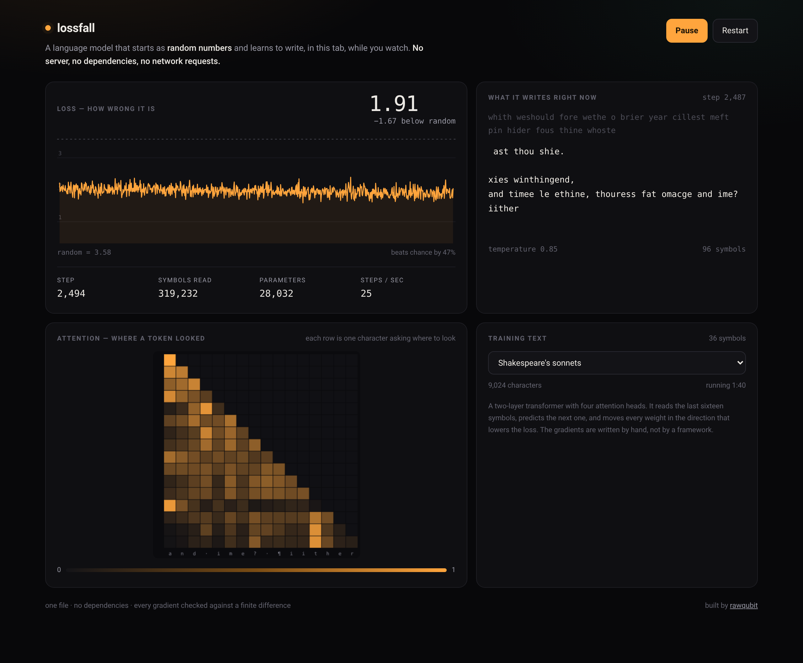

# lossfall

**A language model learns to write, in your browser tab, while you watch.**

[**Open it →**](https://rawqubit.github.io/lossfall/)

There is no build step, no server, no package to install and no network request. Every weight starts as a random number, which is why the first thing it types is noise. It reads the last sixteen characters of Shakespeare's sonnets, predicts the seventeenth, measures how wrong it was, and pushes every one of its 28,032 weights a little in the direction that would have been less wrong. Five seconds later the noise has become word-shaped. A minute later it is writing something that sounds suspiciously like a 16th-century sonneteer who has never met a dictionary.

Nothing is downloaded and nothing is pre-trained. The tab you are looking at is doing the training.



That is a real screenshot: 2,475 steps, loss 1.88, and the model writing `whith weshould fore wethe o brier year cillest meft pin hider fous thine whoste`. Sort of English. Definitely wrong. Getting better.

## What learning looks like

One run from random weights, recorded by `node examples/trace.mjs` — same seed, same corpus, same settings as the page:

| steps | loss | what it writes |
| --- | --- | --- |
| 0 | — | `?och k;zmtia,.t'apbsxyk?lnc'shjp?m?:-i-;c;o,b r !ozw;uxf` |
| 100 | 3.24 | `s to' thi ns ther,hrlout whsevenutoge menntiwet o e` |
| 500 | 2.33 | `ut thon tharinch \n bot whproeso w, shereerins muthst \nin ton lfore` |
| 1,500 | 2.03 | `whand ler's houcp \nwherend wath wheand gonot ome \nthou chye hind wend leeen sust` |
| 3,000 | 1.80 | `iviing die'st see pong ay to thou the nose weres the coumbly \nwit butered thine` |
| 6,000 | 1.57 | `if the tas thou spelvids, \no! defecep thinee fire thee world or evintrar evidess` |

At zero steps it produces the alphabet at random, which is what a model that knows nothing produces. By 100 steps it has discovered that letters form clumps. By 500 it has found word boundaries, by 1,500 syllable structure, and by 6,000 the metre, the apostrophes, and a vocabulary of `thou`, `thine`, `thee` and `die`. Nobody told it any of that; it is all in the weights it moved from watching one character predict the next.

## What is actually running

A character-level transformer — two blocks, four attention heads, a 32-wide embedding, a 16-symbol context — trained by an autograd engine written by hand in the same file. No TensorFlow.js, no ONNX, no WASM blob. Reading the source is the point, so the operators are short:

| file | what it holds |
| --- | --- |
| `engine.js` | tensors, eight backward passes, the model, Adam, sampling |
| `app.js` | the loop, the chart, the attention heatmap, the controls |
| `shell.html` | markup and CSS |
| `corpus.txt` | the first fourteen of Shakespeare's sonnets (public domain) |
| `build.py` | inlines the three scripts and the corpus into `index.html` |
| `index.html` | **the artifact**: one self-contained file, ~45 KB |

`python3 build.py` regenerates `index.html`; `python3 build.py --check` fails if it has drifted from the sources.

## Why you can trust the numbers

An autograd written by hand is exactly the kind of code that is quietly wrong and still trains. The test suite does not take the loss curve's word for it: for every parameter tensor, it perturbs three weights by ±1e-5, measures the change in loss, and compares that against the gradient the backward pass claimed. If one term of one Jacobian is wrong, the test names the parameter and fails.

```bash
node --test tests/engine.test.mjs
```

Eight tests: the finite-difference check, loss falling on the real corpus, sampling determinism, vocabulary integrity, and the step counters. `node tests/page.test.mjs` drives headless chromium, loads `index.html`, and asserts that the page trained, wrote text, drew attention, and did not overflow — because a demo that only works in the author's browser is not a demo.

## The arithmetic, written out

The model is ordinary; the point is that you can read all of it.

- **Attention:** `softmax(QKᵀ / √d + mask) · V`, masked so a position can only look at itself and earlier characters in its own sequence.
- **Layer norm:** per row, zero mean and unit variance, then a learned scale and shift.
- **MLP:** `GELU(xW₁ + b₁)W₂ + b₂`, with the tanh approximation of GELU and its exact derivative.
- **Loss:** mean cross entropy over the positions that predict a real next character.
- **Update:** Adam, global gradient-norm clipping at 1.0, and a short linear warmup.

Every one of those has a matching `back` function next to its forward, and the finite-difference test covers all of them.

## Reading the page

- **Loss** is how wrong the model is, in nats per character. Random guessing scores `ln(vocab) = 3.58`; the dashed line shows that ceiling. The chart starts at the ceiling because that is what a random model scores.
- **What it writes right now** re-samples the model every 0.6 seconds. The faint line above the bright one is the previous sample, so you can see it move. Early samples share the alphabet; later ones share the grammar.
- **Attention** is the last layer of the last sample: one row per character in the context, one column per character it was allowed to look at, brightness equal to weight. The triangle is the causal mask — a character cannot see the future.
- **Training text** can be swapped for this page's own source or for anything you paste, which is a good way to watch a model learn the shape of code instead of prose.

## What it is not

- **Not a useful language model.** 28,032 parameters, a 16-character window, and a nine-kilobyte corpus. It memorizes those fourteen sonnets, badly, and cannot do anything else. The interesting part is that it learns at all, visibly, in front of you.
- **Not fast.** A few dozen steps a second on one CPU core, because the arithmetic is plain JavaScript with no BLAS and no GPU. A bigger model would need a different tool.
- **Not a tutorial in the sense of leaving things out.** Nothing is stubbed, but this is also not a substitute for reading a paper: it is a small complete thing rather than a large approximate one.
- **Not a benchmark.** The loss curve is one run with one seed. Different seeds wobble by a few hundredths.

## License

MIT.

Built by [Srinikhil Chakilam](https://srinikhilchakilam.com). If you leave the tab open for ten minutes, tell me what it writes.